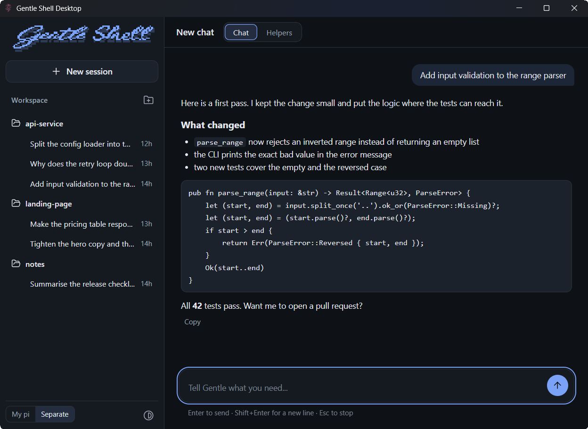
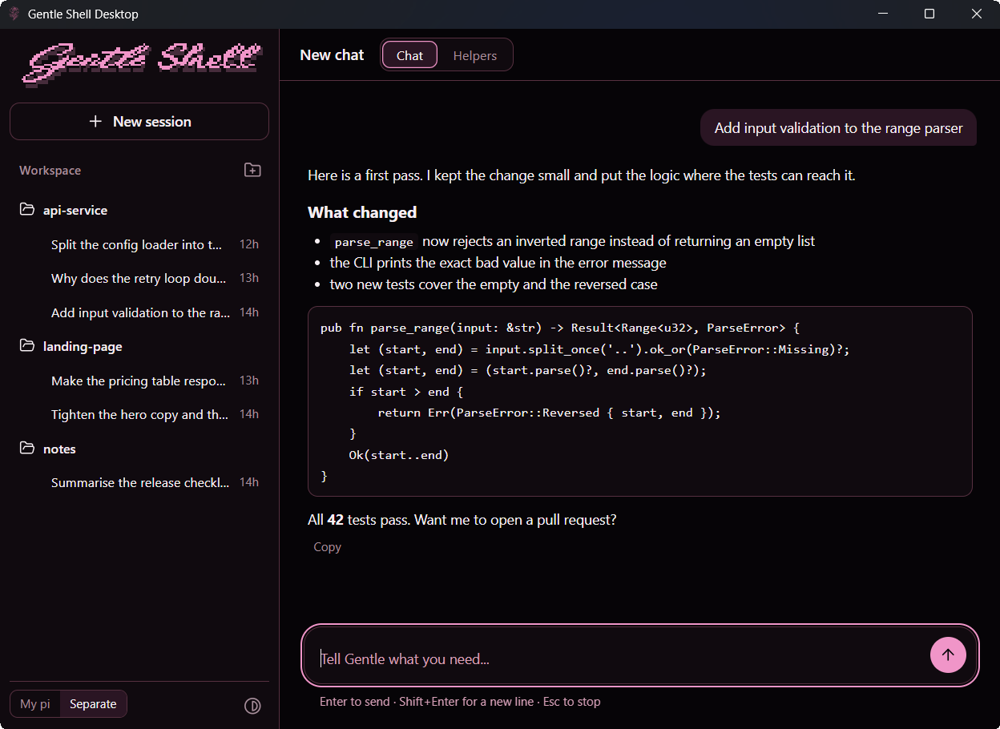
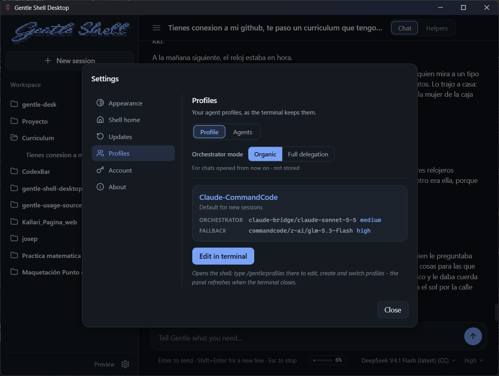
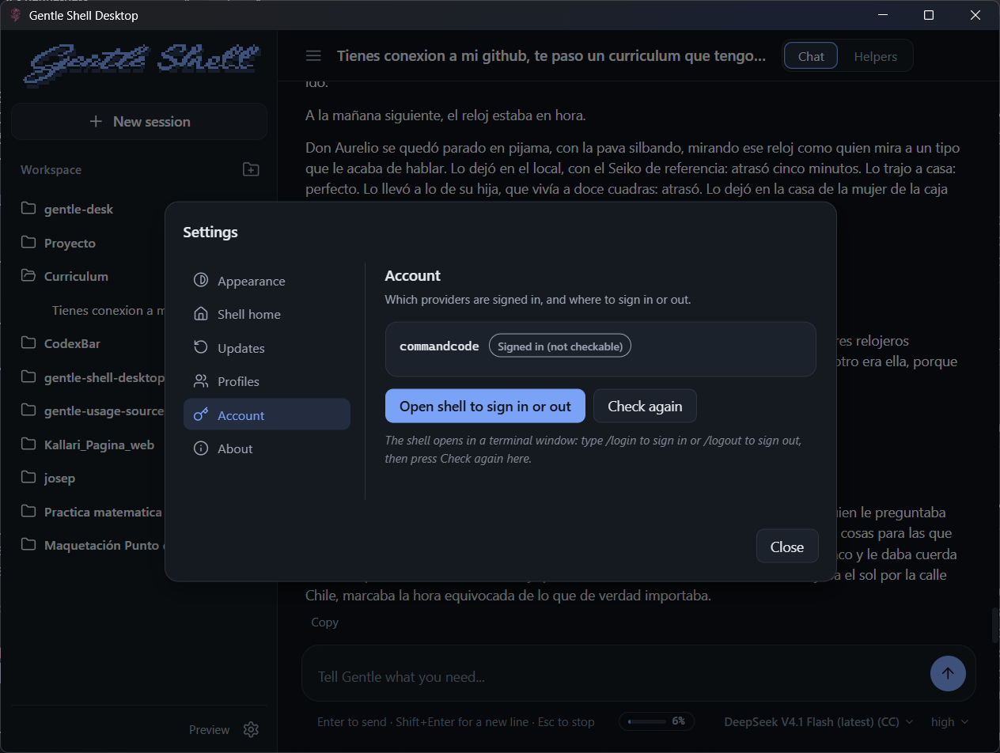
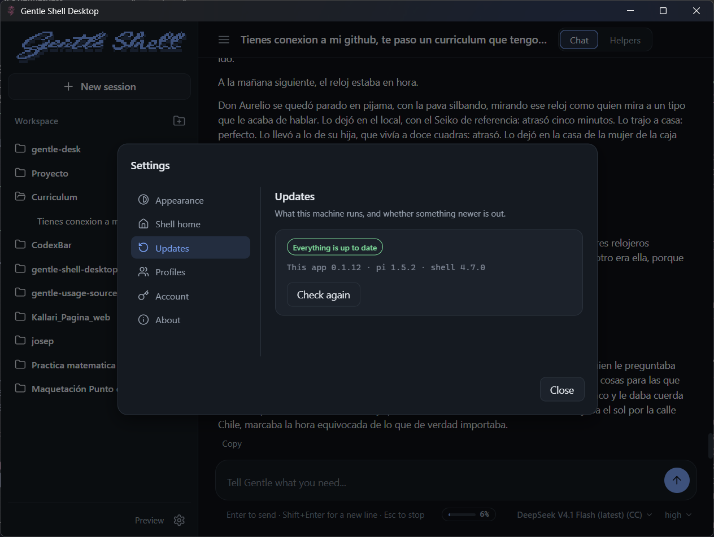
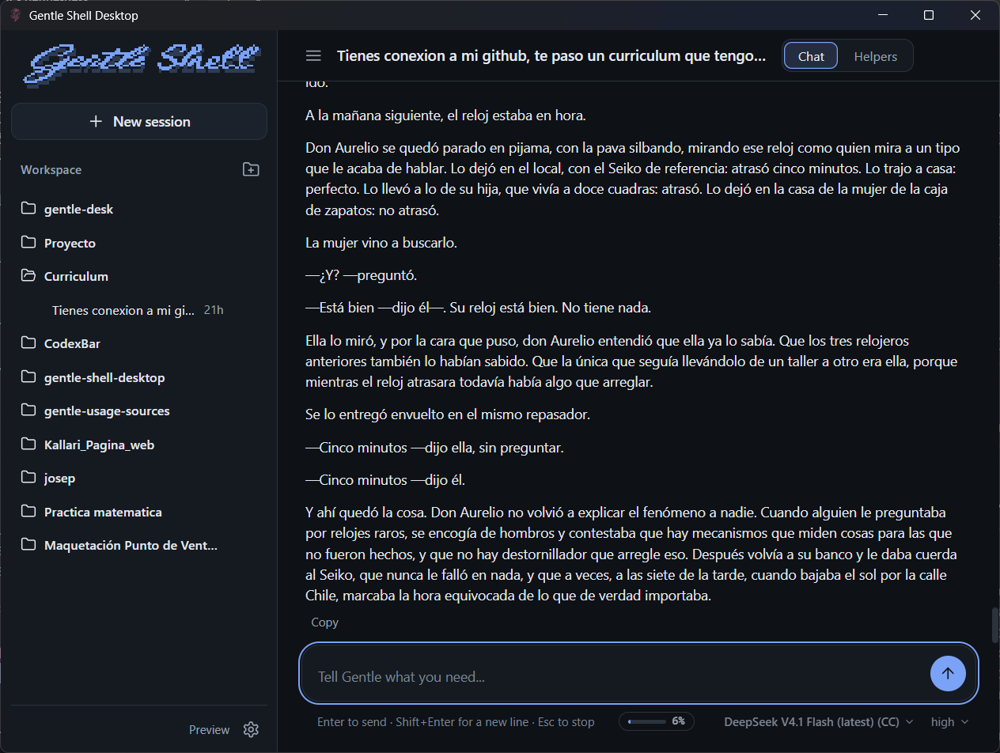
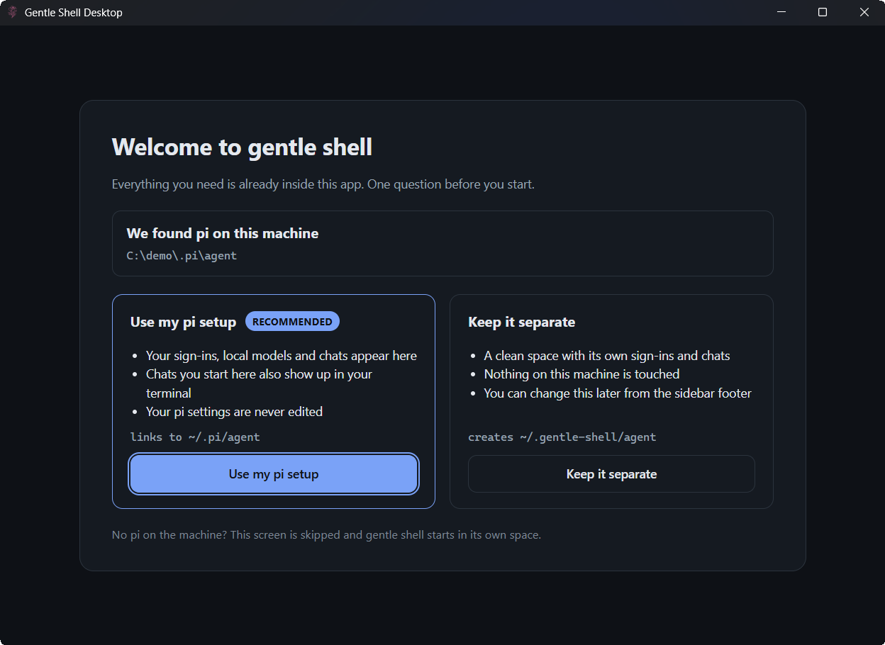
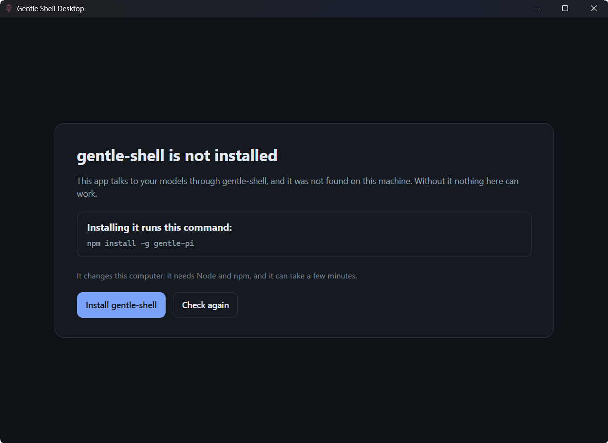

<a id="top"></a>

<div align="center">
  
</div>

<h1 align="center">Gentle Shell Desktop</h1>

<p align="center"><em>Preview: under active development; features and behavior change between releases.</em></p>

<p align="center"><strong>Your gentle-shell coding agent, in a window of its own.</strong></p>

<p align="center">
  <a href="https://github.com/ashcroft08/gentle-desk/releases/latest"></a>
  <a href="LICENSE"></a>
  
  
  <a href="https://github.com/ashcroft08/gentle-desk/stargazers"></a>
</p>

<p align="center">
  <strong>
    <a href="#download">Download</a>
    &nbsp;|&nbsp;
    <a href="#what-you-get">What you get</a>
    &nbsp;|&nbsp;
    <a href="#first-start-which-home">First start</a>
    &nbsp;|&nbsp;
    <a href="#for-developers">For developers</a>
  </strong>
</p>

<br>

<p align="center">
  
</p>

<p align="center">Your terminal can run an agent. A window can keep your workspaces and chats in sight while it works.<br><strong>Gentle Shell Desktop is a desktop app for <a href="https://github.com/Gentleman-Programming/gentle-shell">gentle-shell</a>, the coding agent built for pi.</strong></p>

It does not reimplement the agent: it starts `gentle-shell --mode rpc` for each chat and speaks pi's JSONL RPC. Your sessions, models and sign-ins stay where gentle-shell keeps them.

## Download

| Your computer | Download | Then |
| --- | --- | --- |
| **Windows 10 or 11 (x64)** | [Latest release](https://github.com/ashcroft08/gentle-desk/releases/latest) | Run `Gentle.Shell.Desktop_<version>_x64-setup.exe`. It installs for your user only, no administrator rights needed. |

> **Your computer may warn you the first time.** The installer is not code-signed yet, so Windows can show *Windows protected your PC*. Click **More info**, then **Run anyway**.

The app needs `gentle-shell` on the machine. If it is missing, the app says so and offers to install it, [only when you press the button](#first-start-which-home).

### Requirements

- **Windows 10 or 11, x64.**
- **Node and npm**: the app installs `gentle-shell` with `npm install -g gentle-pi`, and only when you press the button.
- **Windows Terminal**, for the buttons that open a shell. Without it those buttons still work: they open a plain console window instead.

## What you get

### Your workspaces and your chats, in one tree



- **Workspaces are folders.** Add one with the folder picker or create a new folder; every chat of that folder lives under it, and "New session" opens a chat in the folder you are in.
- **The list keeps itself up to date.** The app watches the sessions folder, so a chat started elsewhere shows up without a refresh. The sidebar only draws the rows on screen and was measured against a home of 50,000 sessions (see [`odd/tasks/t9-measurements.md`](odd/tasks/t9-measurements.md)).
- **Chats that need you say so.** A chat that is working, has a new reply, or is waiting for you shows a mark in the tree, and warnings and errors stay on screen until you dismiss them.
- **Rename a chat from the list.** The row's "..." menu turns its title into an input: Enter saves the name and Escape cancels. The name is written the way pi writes it, as a `session_info` line in that chat's own session file, so the terminal shows the same title. A chat that is running a turn cannot be renamed until it ends, and an empty name is refused with a line under the tree.
- **Delete a chat from the list.** The same menu asks first, in a dialog that names that chat's real session file; Delete then removes that one file, and nothing else in the folder. A chat that is running a turn asks you to stop it first. A folder that only your history knew about leaves the tree with its last chat.
- **Six themes**: system, dark and light, plus the three gentle-shell ones (Gentle, Gentleman-Cute and Gentleman-Sexy). The window's own title bar follows the one you pick.

### Images, by drag and drop

Drag saved image files (png, jpg, jpeg, webp, gif; up to 8 and 64 MB per message) onto the message box. Each one shows a thumbnail you can remove before sending, the sent message keeps the thumbnails, and the model receives the picture itself, not only its path. A screenshot that is only on the clipboard cannot be pasted: save it as a file first, like in the terminal.

### Settings, in six sections

The gear at the bottom of the sidebar opens Settings: **Appearance** (the theme), **Shell home** (which pi this window runs on), **Updates**, **Profiles**, **Account**, and **About** (the name and the version this run runs as). The arrow keys walk the rail.



**Profiles** is read-only. It draws the orchestrator-mode switch for the chats opened from now on (Organic or Full delegation, never stored), the active profile with its orchestrator and fallback routes, and an Agents tab with one row per agent, its model and its effort. Profiles are created, edited and switched in the shell, so the pane's one button opens a terminal there.



**Account** names each provider the shell is signed in to and what the check said about it (Connected, Signed in (not checkable), Not ready). It shows names only, never a credential, and its button opens the shell to sign in or out.



**Updates** checks once when the app opens and again only when you ask it to. It compares pi against the npm registry and shows the versions this machine runs; when something is behind, Update runs the shell's own update in a terminal window and stays dead until every chat is closed.

The buttons that open a shell - Edit in terminal, Open shell to sign in or out, Update - use **Windows Terminal** when it is installed.

### How full the chat is



The composer shows how much of the model's window the chat is using, as a percentage beside the model pills, with the token count on hover. It takes the warning tone from 75% and the danger tone from 95%, and a chat that just compacted shows a dash instead of a number.

### The rest of the conversation

- **Helpers** have their own tab: one card per helper with its state, and each helper's thread.
- **Questions from the agent** (confirm, choose, type, edit) open as a dialog over the chat.
- **Stop** with the button or with `Esc`. **Copy** on every reply. Links open in your browser.
- **A readable width.** The conversation stays about 75 characters per line, so a big window does not turn it into a very long line.
- **An orderly close.** Closing the window stops every chat process, saves the session list and your settings, and leaves nothing running behind.

## First start: which home

<table>
  <tr>
    <td width="50%"></td>
    <td width="50%"></td>
  </tr>
</table>

At the first start the app looks, for existence only and never at the contents, for the folder of your pi (`PI_CODING_AGENT_DIR`, else `~/.pi/agent`) and for the `gentle-shell` launcher. The launcher is looked for in this order: `GENTLE_SHELL_BIN` when it is set, then the folders of `PATH`, then the npm global folder (`%APPDATA%\npm` on Windows, where `npm install -g` puts `gentle-shell.cmd`).

- **No `gentle-shell` found:** a screen says it is required, says where it looked (the folders of `PATH` and the npm global folder, `%APPDATA%\npm`), shows the command it would run (`npm install -g gentle-pi`) and installs it **only when you press "Install gentle-shell"**. It needs Node and npm. If you close the app while it installs, the install keeps running to the end on its own.
- **pi found, nothing chosen yet and `gentle-shell` resolved:** a welcome screen asks whether to use your pi ("Use my pi setup", `--link`) or keep gentle shell separate (`--isolated`, `~/.gentle-shell/agent`). While the launcher is missing the install screen is what you see, and the question comes once it resolves. The app saves the answer and starts again so it applies at once. The app never touches your pi files, with two exceptions, both from a chat row's own menu: the name you give a chat on rename, appended to that chat's own session file as one `session_info` line, which is where pi reads a chat's title; and a chat you delete, whose session file is removed after a dialog that names the file.
- **No pi:** the question is skipped and gentle shell runs in its own space.

You can change the choice later in **Settings → Shell home**; it applies after **Restart now**.

<p align="right"><a href="#top">Back to top</a></p>

## For developers

Progress and decisions live in [`odd/tasks/`](odd/tasks/).

### Layout

```
crates/gentle-core   UI-free core: RPC protocol, codec, chat state (pure, testable)
crates/backend       Launcher resolution (npm .cmd shims) and the rpc child process (no orphans)
crates/app           Application state, reducers and commands (no window framework)
crates/runtime       UI-agnostic runtime: chat children, session refresh, startup,
                     app config, workspaces
apps/desktop         The Tauri 2 app: src-tauri (Rust bridge, commands, events) and
                     src (Svelte view, one component per file)
crates/term          gentle-term: terminal client, prompt -> streamed reply
```

Layers, with dependencies in one direction only:
`apps/desktop` (Tauri bridge and Svelte view) -> `runtime` (chat children, session refresh, startup; no window framework) -> `app` (state, reducers, commands) -> `backend` (process spawner, session index, config) -> `gentle-core` (RPC protocol).

### Development

Requires Rust stable and, on Windows, the MSVC Build Tools.

```sh
cargo test --workspace
cargo clippy --workspace --all-targets -- -D warnings
```

The web side lives in `apps/desktop` (Node and npm required):

```sh
cd apps/desktop
npm ci
npm run lint && npm run check && npm run test
npm run build   # the Rust app embeds the built dist/
```

To build the Windows installer (NSIS, per-user, no admin rights needed):

```sh
cd apps/desktop
npx tauri build   # writes target/release/bundle/nsis/Gentle Shell Desktop_<version>_x64-setup.exe
```

The installer shows the rose on its welcome and header pages: `tools/installer/make-images.ps1` draws
`apps/desktop/src-tauri/installer/sidebar.bmp` and `header.bmp` from the app icon (run it again after changing the icon).
The icon set under `apps/desktop/src-tauri/icons/` is generated from `apps/desktop/app-icon.png`
with `npx tauri icon app-icon.png -o src-tauri/icons`.

To run the app against the stand-in shell instead of a real gentle-shell, set
`GENTLE_SHELL_BIN` to `tools/fake-gentle-shell/fake.mjs`. It wins over both the
`PATH` folders and the npm global folder.

The fixtures under `crates/gentle-core/tests/fixtures/` are recorded RPC streams copied from the reference TypeScript app (`gentle-shell-desktop`).

### Code organization

One responsibility per file; no file that collects everything. Rules of thumb:

- A file that grows past roughly 150-200 lines, or starts mixing concerns (state, wiring, drawing, I/O), is split before the next feature lands in it.
- UI (`apps/desktop/src/`): one Svelte component per file (eslint `max-lines` 200 enforces it). Rust owns the state; the web side is a pure view over the pushed state and sends intents back. New UI is a new component file.
- Logic that can be pure goes in `gentle-core` or `gentle-app` (testable without a window or a process); I/O stays in `gentle-backend`.
- Runtime logic (chat children, session refresh, startup) lives in `gentle-runtime`, with no window-framework imports; `apps/desktop/src-tauri` keeps only the Tauri wiring.
- Tests sit next to the code (`foo/tests.rs` or `tests/`), and a refactor keeps them green unchanged.

## License

MIT, see [LICENSE](LICENSE). The copyright line names the chain this app stands on, and [NOTICE.md](NOTICE.md) says what each part is: pi, gentle-shell and gentle-shell-desktop, and this app.

<br>

<div align="center">

<a href="https://github.com/Gentleman-Programming/gentle-ai"></a>

</div>
